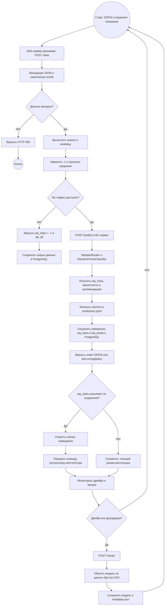
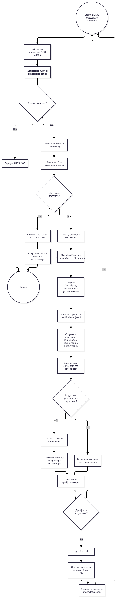
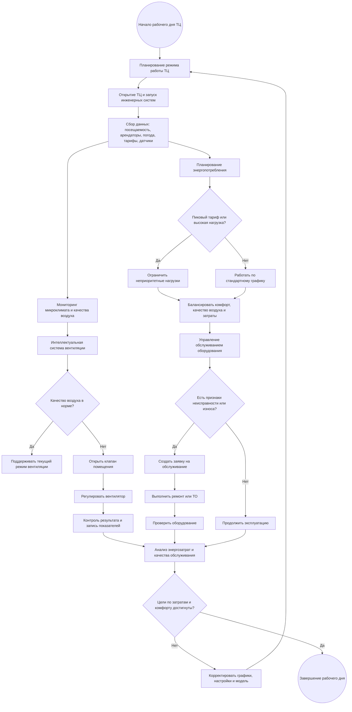
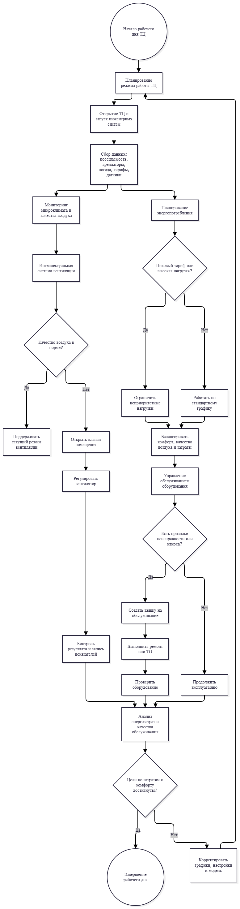

# Model Card — MLAIRQuality Indoor Air Quality Classifier

## 1. Сведения о модели

| Поле | Значение |
|---|---|
| Название модели | MLAIRQuality Indoor Air Quality Classifier |
| Версия | Определяется в `artifacts/metadata.json` |
| Тип задачи | Многоклассовая классификация |
| Алгоритм | `RandomForestClassifier` из scikit-learn |
| Пайплайн | `SimpleImputer` → `StandardScaler` → `RandomForestClassifier` |
| Целевая переменная | `iaq_class` |
| Классы | 0–5 |
| Основная метрика | `f1_macro` |
| Репозиторий | https://github.com/IlyyaNeustroev/MLOps_AirQuality |
| Авторы | Илья Неустроев, Роман Лещишин|
| Версия scikit-learn при сохранении модели | 1.5.1 |
| Random state | 42 |

## 2. Назначение модели

Модель предназначена для оценки качества воздуха в отдельных помещениях больших зданий на основе показаний датчиков. Она классифицирует текущее состояние воздуха в одну из шести категорий IAQ и возвращает рекомендацию для системы вентиляции.

Модель является частью интеллектуальной системы контроля вентиляции: если качество воздуха в помещении ухудшается, система может направить команду на открытие клапана подачи воздуха и на контроллер вентилятора. Это позволяет вентилировать помещения адресно, а не централизованно и равномерно.

### Решаемая задача

**Задача:** многоклассовая классификация индекса качества воздуха в помещении.

Модель по текущим показаниям датчиков и вычисленным временным признакам определяет класс:

| Класс | Интерпретация |
|---:|---|
| 0 | Отлично |
| 1 | Хорошо |
| 2 | Удовлетворительно |
| 3 | Плохо |
| 4 | Очень плохо |
| 5 | АВАРИЯ! |

Модель не прогнозирует будущую концентрацию загрязнителя и не оценивает абсолютное значение IAQ: она определяет категорию качества воздуха для текущего измерения.

## 3. Входные данные

Модель принимает вектор из **16 признаков**, определённый в `FEATURE_COLUMNS` файла `src/airquality/constants.py`.

Признаки и группы данных:

| Группа | Признаки / данные | Источник |
|---|---|---|
| Идентификация помещения | `room_id` | JSON-пакет ESP32 |
| Время измерения | `date`, `time` | JSON-пакет ESP32 |
| Производные временные признаки | `season`, `weekday` | Вычисляются на сервере из `date` |
| Микроклимат | `temp`, `hum` | Датчики ESP32 |
| Загрязнение воздуха | `mq7`, `ens_co2` и другие датчики из набора из 15+ полей | Датчики ESP32 |


### Предобработка

- Значения `-1` и пропуски заменяются средними значениями из `DEFAULT_MEANS`.
- Типы данных приводятся к `int` / `float`.
- Из даты вычисляются `season` и `weekday`.
- Признаки масштабируются `StandardScaler` внутри единого sklearn-пайплайна.
- Пайплайн сохраняется как один объект `joblib`, поэтому предобработка и модель не могут разойтись при инференсе.

## 4. Выходные данные

ML-сервис `POST /predict` возвращает:

| Поле | Тип | Описание |
|---|---|---|
| `iaq_class` | int, 0–5 | Предсказанный класс качества воздуха |
| Вероятности классов | массив / JSON | Результат `predict_proba` для классов 0–5 |
| `recommendation` | string | Текстовая рекомендация, сформированная по классу |

Пример ответа веб-сервера:

```json
{
  "status": "success",
  "packet_number": 123,
  "iaq_class": 2,
  "recommendation": "🟡 Удовл."
}
```

Если ML-сервис недоступен, веб-сервер возвращает `iaq_class = -1` и `ML off`; приём данных от ESP32 при этом не останавливается.

## 5. Обучение

Обучение выполняется командой:

```bash
poetry run airquality-train --data data/<файл>.csv
```

Для полного подбора гиперпараметров:

```bash
poetry run airquality-train --data data/<файл>.csv --full
```

### Процедура обучения

- Данные читаются из CSV.
- Выполняется AutoML-подбор через `RandomizedSearchCV`.
- Целевая метрика подбора — `f1_macro`.
- Быстрый режим: `n_iter = 3`, `cv = 2`, ограниченное пространство гиперпараметров.
- Полный режим: `n_iter = 5`, `cv = 3`, расширенное пространство гиперпараметров.
- Модель сохраняется в `artifacts/air_quality_model.joblib`.
- Вместе с моделью сохраняется паспорт `metadata.json`: версия, метрики, хэш данных и версия scikit-learn.
- Отчёты обучения сохраняются в `reports/`, журнал экспериментов — в `monitoring/experiments.jsonl`.

### Лучшие гиперпараметры из лога

```json
{
  "clf__n_estimators": 120,
  "clf__min_samples_split": 2,
  "clf__min_samples_leaf": 2,
  "clf__max_features": "sqrt",
  "clf__max_depth": 10,
  "clf__bootstrap": true
}
```

## 6. Метрики

Основная метрика — **F1 macro**. Она выбрана потому, что классы могут быть несбалансированными, а редкий, но критичный класс 5 («АВАРИЯ!») особенно важно корректно распознавать.

| Метрика | Train | Test |
|---|---:|---:|
| Accuracy | 0.9323 | 0.9304 |
| F1 macro | 0.9077 | 0.9057 |

Дополнительно формируется `classification_report` с precision, recall и F1 по каждому классу. Отчёты сохраняются в `reports/train_report_*.txt` и `reports/train_report_*.json`.

## 7. Данные для обучения и переобучения

- Обучающий датасет не хранится в Git.
- Датасет генерируется скриптом `DA/gen2.py`.
- CSV для обучения размещается в каталоге `data/`.
- Переобучение доступно через `POST /retrain`.
- Переобучение возможно:
  - на последних `N` записях из PostgreSQL, например `{"limit": 10000}`;
  - на CSV-файле из каталога `data/`, например `{"csv_file": "file.csv"}`.
- После переобучения обновляются модель, `metadata.json`, отчёты и журнал экспериментов.

## 8. Ограничения

- Модель обучена для помещений, оснащённых совместимыми датчиками ESP32; её нельзя без валидации переносить на другие типы датчиков или здания с иной конфигурацией вентиляции.
- Классификация зависит от корректности показаний датчиков; сбои, пропуски и значения `-1` заменяются средними, что может маскировать реальную неисправность датчика.
- Замена пропусков средними не является полноценной обработкой длительного отсутствия данных.
- Модель определяет текущий класс качества воздуха, но не прогнозирует его изменение в будущем.
- Класс 5 («АВАРИЯ!») может быть редким, поэтому при переобучении важно контролировать recall и precision именно для этого класса, а не только общую accuracy.
- Модель, сохранённая под scikit-learn 1.5.1, должна быть переобучена после обновления версии библиотеки.
- Датасет и обученная модель не хранятся в репозитории, поэтому воспроизводимость зависит от доступности исходного CSV или данных в PostgreSQL.

## 9. Особенности применения

- Модель используется в online-режиме через `POST /predict`; обучение и переобучение выполняются отдельно.
- Веб-сервер принимает данные от ESP32 на `POST /data`, вызывает ML-сервис, сохраняет измерение и прогноз в PostgreSQL и возвращает результат клиенту.
- Вероятности классов доступны через `predict_proba` и могут использоваться для более осторожной логики управления вентиляцией.
- Рекомендуется не принимать управляющее решение только по одному классу: учитывать вероятность класса, историю измерений комнаты и состояние оборудования.
- Для мониторинга предусмотрен `POST /monitoring/drift`, который сравнивает текущий и базовый CSV и рассчитывает PSI-подобные оценки по признакам.
- При дрейфе распределения признаков или ухудшении метрик следует провести диагностику данных и при необходимости переобучить модель.

## 10. Роль модели в бизнес-процессе

Модель — элемент контура адаптивного управления вентиляцией.

```text
ESP32 / датчики помещения
        ↓
JSON-пакет показаний
        ↓
Flask web-server: /data
        ↓
Валидация и вычисление season, weekday
        ↓
ML-сервис: /predict
        ↓
iaq_class + вероятности + рекомендация
        ↓
Сохранение в PostgreSQL
        ↓
Управление клапаном и вентилятором
        ↓
Мониторинг дрейфа и качества модели
        ↓
Переобучение при необходимости
```

### Бизнес-эффект

- Снижение перерасхода электроэнергии за счёт адресной вентиляции.
- Более равномерное качество воздуха в помещениях.
- Уменьшение износа оборудования за счёт исключения ненужной работы вентиляции.
- Снижение зависимости от ручной настройки и человеческого фактора.
- Более рациональное использование рекуператора и снижение потерь тепла.
- Возможность реагировать не только на присутствие людей, но и на другие источники загрязнения, например продукты или химические вещества.

### Цели процесса

- Обеспечить комфортные и безопасные условия для посетителей, сотрудников и арендаторов.
- Поддерживать нормативное качество воздуха в помещениях.
- Снизить перерасход электроэнергии за счёт адресной вентиляции.
- Уменьшить износ вентиляционного оборудования.
- Сократить ручное управление и зависимость от человеческого фактора.
- Повысить эффективность использования рекуператора и снизить потери тепла.
- Собирать данные для анализа эксплуатационных затрат и планирования бюджета.

### Границы процесса

**Входы:**

- график работы торгового центра;
- данные о посещаемости и арендаторах;
- показания датчиков температуры, влажности, CO2, газовых датчиков и других сенсоров;
- данные о погоде;
- тарифы и данные энергопотребления;
- заявки на обслуживание и жалобы.

**Выходы:**

- поддерживаемый микроклимат и качество воздуха;
- управляющие команды клапанам и вентиляторам;
- записи измерений и прогнозов в базе данных;
- отчёты по энергопотреблению;
- заявки на обслуживание оборудования;
- рекомендации по корректировке режимов и бюджета.

**Критерии завершения цикла:**

- рабочий день завершён;
- достигнуты целевые показатели комфорта и энергопотребления;
- сформированы отчёты и, при необходимости, корректирующие действия.


## 11. BPMN-схема процесса

### Схема переобучения




### Роли в BPMN-процессе

| Роль / дорожка | Операции |
|---|---|
| ESP32 / помещение | Сбор показаний, отправка JSON, исполнение команд клапана и вентилятора |
| Web Server | Приём данных, валидация, вычисление признаков, сохранение в БД, возврат ответа |
| ML Service | Предобработка, классификация, вероятностный вывод, рекомендации |
| MLOps / Monitoring | Мониторинг дрейфа, логирование прогнозов, переобучение, версионирование модели |
| PostgreSQL | Хранение сырых измерений, вычисленных признаков, прогнозов и вероятностей |

### Схема бизнес-процесса




## 12. Мониторинг и эксплуатация

- `GET /status` — проверка загрузки модели, метаданных и списка признаков.
- `GET /health` и `GET /monitoring/health` — проверки работоспособности ML-сервиса.
- `POST /monitoring/drift` — сравнение двух CSV и расчёт PSI-подобных оценок дрейфа.
- `monitoring/predictions.jsonl` — журнал прогнозов ML-сервиса.
- `monitoring/experiments.jsonl` — журнал запусков обучения.
- `reports/` — человекочитаемые и машинночитаемые отчёты обучения.

## 13. Этические и эксплуатационные соображения

- Ошибочная классификация может привести к недостаточной вентиляции либо к избыточной работе оборудования.
- Особенно важно контролировать качество распознавания класса 5, поскольку его пропуск может быть опаснее ложной тревоги.
- Система не должна полностью отключать возможность ручного вмешательства оператора.
- Необходимо логировать версию модели, источник данных и прогноз для последующего разбора инцидентов.
- При изменении состава датчиков, помещений или режима эксплуатации здания требуется переобучение и повторная валидация.

## 14. Экономический эффект

| Бизнес-задача | Вклад интеллектуальной вентиляции |
|---|---|
| Снижение затрат на электроэнергию | Вентиляция усиливается только в помещениях с ухудшением качества воздуха |
| Комфорт посетителей и арендаторов | Поддерживается приемлемый уровень IAQ в отдельных зонах |
| Снижение износа оборудования | Исключается ненужная постоянная работа вентиляции |
| Сокращение ручного труда | Уменьшается зависимость от ручной настройки системы |
| Эффективная рекуперация | Снижаются потери нагретого воздуха через вытяжку |
| Планирование бюджета | Данные о работе вентиляции и энергопотреблении используются в отчётности |
| Управление инцидентами | Класс «АВАРИЯ!» и деградация качества воздуха могут инициировать заявку инженерной службе |
