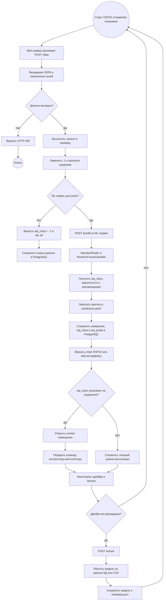
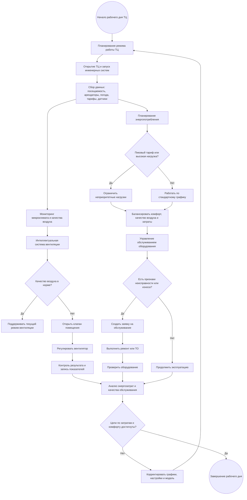

## BPMN-схемs процесса

### Схема переобучения

### Роли в BPMN-процессе

| Роль / дорожка | Операции |
|---|---|
| ESP32 / помещение | Сбор показаний, отправка JSON, исполнение команд клапана и вентилятора |
| Web Server | Приём данных, валидация, вычисление признаков, сохранение в БД, возврат ответа |
| ML Service | Предобработка, классификация, вероятностный вывод, рекомендации |
| MLOps / Monitoring | Мониторинг дрейфа, логирование прогнозов, переобучение, версионирование модели |
| PostgreSQL | Хранение сырых измерений, вычисленных признаков, прогнозов и вероятностей |

### Схема бизнес-процесса

