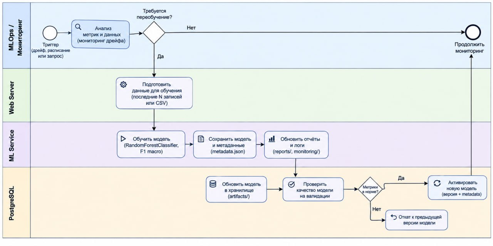
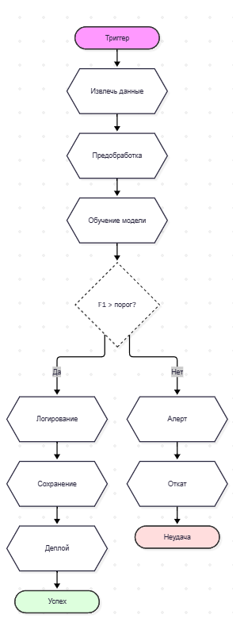

## BPMN-схема процесса переобучения

### Схема переобучения

Основные этапы процесса переобучения
1. Триггер запуска
Запуск по расписанию или из-за ухудшения метрик / дрейфа данных.

    Передаётся сигнал старта и причина запуска.

2. Получение и подготовка данных
Выгрузка свежих записей из БД, очистка, приведение типов, предобработка признаков.

    Передаётся готовый DataFrame и хеш датасета.

3. Обучение модели
Разбиение на train/test, подбор гиперпараметров через RandomizedSearchCV, обучение пайплайна.

    Передаются обученная модель, метаданные и метрики.

4. Проверка качества
Сравнение метрик (например, F1) с порогом, проверка на аномалии.

    Передаётся вердикт «пройдено / не пройдено» и отчёт.

5. Принятие решения
Если метрики в норме — одобряем публикацию; если нет — отклоняем.

    Передаётся флаг is_approved и ссылка на артефакты.

6. Регистрация модели
Сохранение модели в хранилище, регистрация в MLflow, запись метаданных.

    Передаётся URI артефакта и статус регистрации.

7. Деплой модели
Обновление активной версии в сервисе, инвалидация кэша, обновление дашборда.

    Передаётся статус active и готовность к инференсу.

8. Действия при неудаче
Сохранение черновика, отправка алерта, откат к предыдущей версии, фиксация причины.

    Передаётся статус rejected, ссылка на артефакты провала и уведомление команды.
