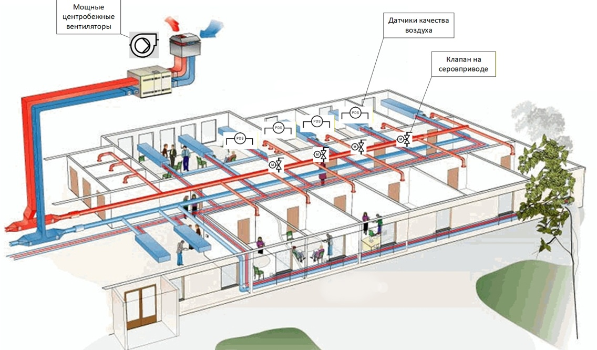
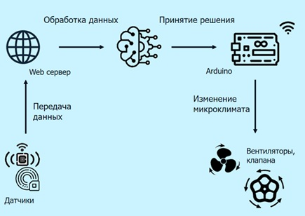
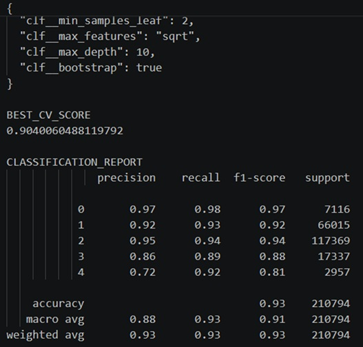
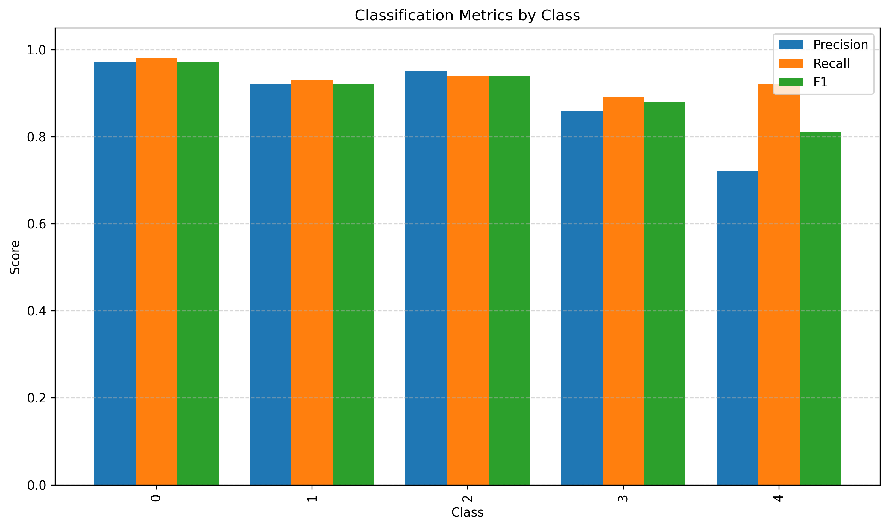
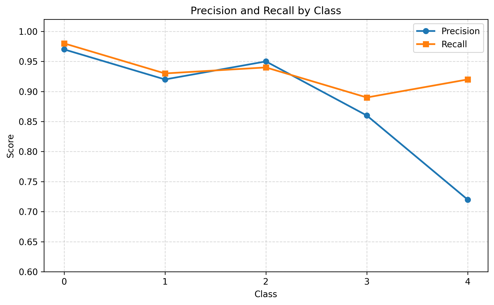
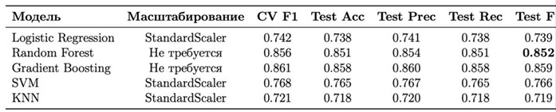
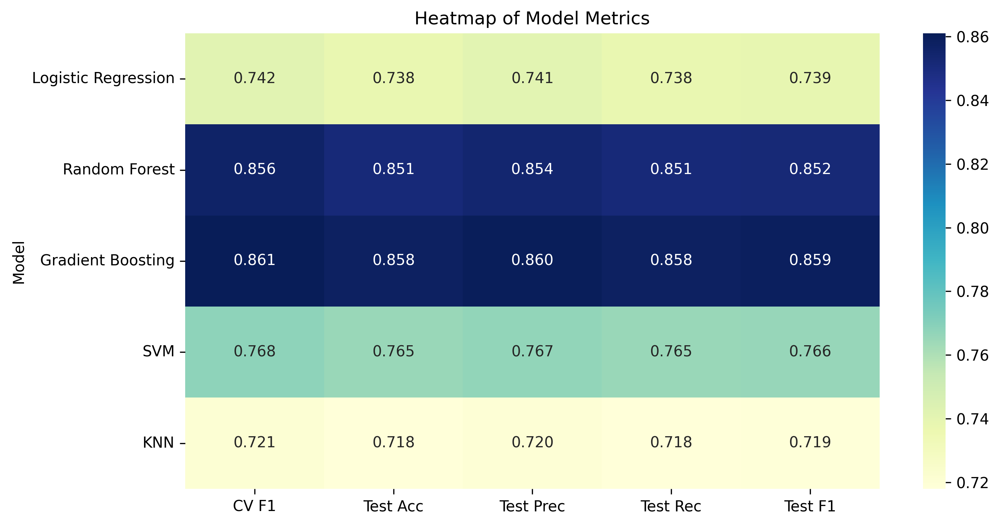
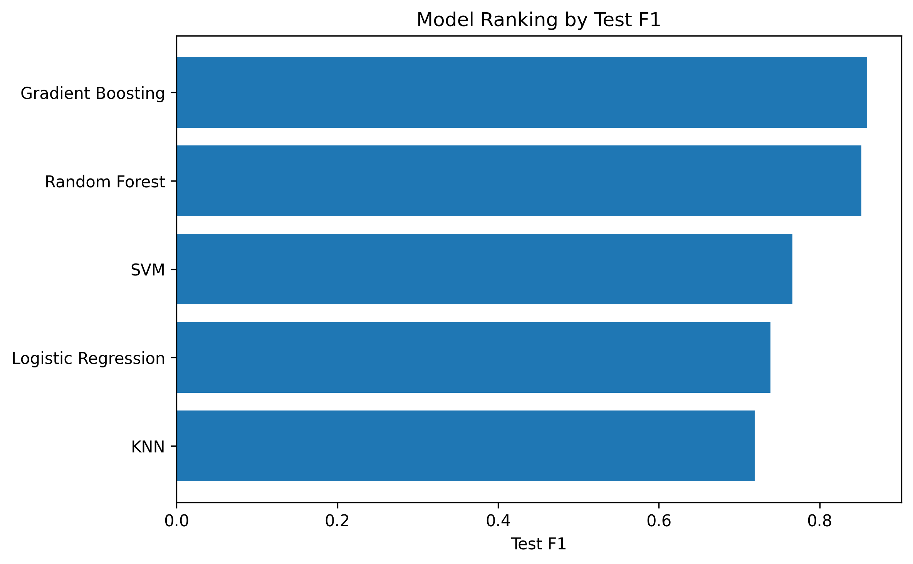

## MLAIRQuality – интеллектуальная система контроля качества воздуха в системах вентиляции больших зданий. #

Авторы:

Неустроев Илья

Харлов Максим

Лещишин Роман

Савельев Денис

___

## Описание бизнес-задачи ##

Коротко о том, в чем состоит проблема и почему эту задачу можно решить с помощью ML-модели.

Традиционные системы не адаптивны, они работают по заданному алгоритму, пусть даже и с привязкой к показаниям датчиков, они не хранят историю, не используют эту информацию для прогнозирования и управления системой.

В итоге имеем:

- перерасход энергии, когда вентиляция работает там, где не нужно (в отдельных помещениях);
- неравномерное качество воздуха. Такая ситуация возникает, когда факторы загрязнения распределяются по зданию неравномерно, а система вентиляции работает равномерно централизованно;
- износ оборудования. Это следствие пустопорожней работы;
- ручная регулировка – зависимость от человеческого фактора. Часто вентиляция запитана от света в помещениях, который используется как признак присутствия человека. Однако фактором загрязнения может быть не только человек (скоропортящейся продукты, химические вещества);
- Потери тепла через рекуператор. Довольно часто в приточно-вытяжных системах вентиляции используют рекуператоры для того, чтобы в теплообменнике нагреть приточный воздух вытяжным. Раз мы все равно нагретый вытяжной воздух выбрасываем в атмосферу, то рационально будет нагреть им напоследок приточный воздух. Однако, в классических системах, нагретый воздух может попусту уходить в вытяжку из помещения, ведь система работает централизованно и там, где не требуется;

Имеются магистральные воздуховоды приточной и вытяжной вентиляции, от которых выполнены ответвления в отдельные помещения:



В каждом помещении имеется Arduino с датчиками с wi-fi модулем и клапаном на сервоприводе. С настраиваемой частотой Arduino передает данные с датчиков на web-сервер, на котором запущено наше приложение с ML-моделью. Эти приложение накапливает статистику, периодически переобучает модель и выполняет предикт индекса качества воздуха в отдельном помещении. Если он понизился, мы знаем где, посылаем json Arduino с командой открыть клапан и json контроллеру вентилятора, это тоже Arduino с wi-fi модулем и мощными твердотельными реле (мощная нагрузка до 10-100 КВт).

---

## Описание схемы пайплайна ##



**1. Полный цикл данных:**

1.  Сбор данных
    - ESP32 отправляет JSON‑пакеты с показаниями датчиков на Flask‑сервер (эндпоинт /data).
    - В пакете: room_id, дата/время, показания датчиков (temp, hum, mq7 и т. д.).
2.  Предварительная обработка
    - Сервер извлекает дату из поля date, вычисляет season (по месяцу) и weekday (день недели).
    - Обновляет состояние своей комнаты (`SensorState`: отдельная запись на каждую комнату, доступ под блокировкой — данные разных помещений не смешиваются).
3.  Прогноз ML‑модели
    - Веб-сервер передаёт данные комнаты ML-сервису по HTTP (`POST /predict`, адрес из `ML_SERVICE_URL`). Если ML-сервис недоступен, ответ содержит `iaq_class = -1` и `ML off`, приём данных не останавливается.
    - ML-сервис заменяет значения -1 и пропуски на средние (`preprocess_features`).
    - Пайплайн sklearn: SimpleImputer → StandardScaler → RandomForestClassifier (скалер хранится внутри модели, поэтому не может «разойтись» с ней).
    - Классифицирует качество воздуха (iaq_class от 0 до 5) и возвращает вероятности классов.
    - Добавляет рекомендацию (recommendation) на основе класса.
4.  Сохранение в БД
    - Функция `build_measurement_record` приводит типы и подставляет значения по умолчанию, `save_measurement` выполняет параметризованный INSERT.
    - Сохраняет запись в таблицу sensor.data PostgreSQL:
       - сырые данные датчиков;
       - вычисленные season, weekday;
       - предсказанный iaq_class;
       - iaq_proba (JSON с вероятностями классов).
5.  Обратная связь
    - Клиент (ESP32 или веб‑интерфейс) получает ответ:

```json
{
  "status": "success",
  "packet_number": 123,
  "iaq_class": 2,
  "recommendation": "🟡 Удовл."
}
```

6.  Переобучение (опционально)
    - По запросу `POST /retrain` модель переобучается на последних N записях из БД (`limit`) или на CSV-файле из каталога `data/` (`csv_file`).
    - Сохраняет обновлённую модель (вместе со скалером) и `metadata.json`.

**2. Подробная логика работы пайплайна:**

1\. Обучение модели

Команда `poetry run airquality-train --data data/<файл>.csv`:

- читает CSV
- делает AutoML-подбор через RandomizedSearchCV
- сохраняет модель в artifacts/ (`air_quality_model.joblib` + `metadata.json`: версия, метрики, хэш данных, версия sklearn)
- пишет отчёт в reports/
- пишет метаданные и эксперименты в monitoring/

2\. Работа Flask-сервера

Когда ML-сервис получает запрос на /predict, он проверяет входные данные (pydantic; ошибка → 400) и:

- делает предсказание
- пишет строку в monitoring/predictions.jsonl
- возвращает JSON с iaq_class, вероятностями и рекомендацией

3\. Мониторинг дрейфа

Когда вызываем /monitoring/drift, сервер:

- сравнивает два CSV из каталога `data/` (передаются только имена файлов, выход за пределы каталога запрещён)
- строит список признаков с PSI-подобной оценкой
- сохраняет отчёт в monitoring/drift_YYYYMMDD_HHMMSS.csv

4\. Результаты обучения

- Отчёты обучения: в папке reports/: train_report_\*.txt — человекочитаемый отчёт, train_report_\*.json — машинно-читаемая сводка с метриками и classification_report.
- Логи экспериментов: файл monitoring/experiments.jsonl — это построчный JSON - каждая строка — один запуск обучения; Удобно смотреть через jq, Python, VS Code или лог-вьювер.

**3. ETL‑процесс (Extract‑Transform‑Load)**

1\. Extract (извлечение)

- Источник: JSON‑запросы от ESP32 (HTTP POST /data).
- Метаданные: room_id, date, time.
- Сырые данные: 15+ полей датчиков (temp, hum, mq7, ens_co2 и др.).

2\. Transform (преобразование)

- Вычисление признаков:
   - season — по месяцу из date (get_season_by_month).
   - weekday — день недели (isoweekday()).
- Очистка данных:
   - замена -1 и пропусков → заранее рассчитанные средние `DEFAULT_MEANS` (в `preprocess_features`);
   - приведение типов (int, float) и подстановка значений по умолчанию (`build_measurement_record`).
- Масштабирование: StandardScaler внутри пайплайна модели (обучается вместе с ней).
- Прогноз: классификация iaq_class (0–5) + вероятности.
- Пост‑обработка: генерация текстовой рекомендации (get_recommendation).

3\. Load (загрузка)

- Приёмник: таблица sensor.data в PostgreSQL.
- Поля: все сырые и вычисленные признаки + iaq_class, iaq_proba, packet_count.
- Формат: структурированная запись с временными метками и метаданными комнаты.

---

## Архитектура ML‑модели ##

Модель: RandomForestClassifier (sklearn)

Пайплайн: SimpleImputer (медиана) → StandardScaler → RandomForestClassifier (`random_state=42`, `n_jobs=-1`).

Гиперпараметры подбираются AutoML (RandomizedSearchCV, метрика `f1_macro`):

- быстрый режим (`FAST_MODE=true`): n_estimators ∈ {80, 120}, max_depth ∈ {10, 15}, min_samples_split ∈ {2, 4}, min_samples_leaf ∈ {1, 2}, max_features = sqrt; `n_iter = AUTOML_ITER` (по умолчанию 3), `cv = 2`;
- полный режим (`airquality-train --full`): n_estimators ∈ {100, 150, 200}, max_depth ∈ {10, 15, 20}, max_features ∈ {sqrt, log2}, bootstrap ∈ {True, False}; `n_iter = 5`, `cv = 3`.

Вход: 16 признаков (`FEATURE_COLUMNS` в `src/airquality/constants.py`).

Выход: класс iaq_class (0–5):  
· 0: «Отлично»;  
· 1: «Хорошо»;  
· 2: «Удовлетворительно»;  
· 3: «Плохо»;  
· 4: «Очень плохо»;  
· 5: «АВАРИЯ!».

Оценка: classification_report (точность, полнота, F1).

Сохранение: joblib — единый объект Pipeline (предобработка + модель) и паспорт модели `metadata.json`.

Особенности:  
· обработка пропусков (-1 → среднее);  
· переобучение по запросу (`/retrain` из БД или CSV);  
· вероятностный вывод (predict_proba) для интерпретации;  
· быстрый режим подбора: ограниченное пространство гиперпараметров, `n_iter=3`, `cv=2`;  
· режим продакшн: online — только `predict()` в ML-сервисе; offline — обучение командой `airquality-train` (вручную или по расписанию).

**Отчет по метрикам с применением AutoML:**



Визуализация




В ходе решения задачи, был рассмотрен также вариант применения чистой модели RandomForestClassifier (в виду требования по производительности системы). При этом были получены такие метрики:



Визуализация




Модель RandomForest показала устойчиво хорошие показатели по всем метрикам. Преимущества такого подхода:

1. отличные показатели
2. не требует масштабирования признаков, значит проще внедрить (StandardScaler в пайплайне оставлен для единообразия предобработки)
3. не чувствительна к мультиколлинеарности
4. быстро обучается
5. дает интерпретацию результата, на последней картинке коэффициенты, которые дала модель. Видно, какой параметр сильнее будет влиять
6. Устойчив к выбросам в отличии от градиентного бустинга : выбросы, шум и нелинейности, которые «ломают» градиентный бустинг, но Random Forest переносит спокойно.

<br/>При выборе модели смотрим на F1 метрику, т.к.:

- устойчивее к дисбалансу классов чем accuracy. Ситуация с классом 5 (когда все оч плохо) может встречаться редко, но ее очень важно предсказывать. Если использовать accuracy, то можно получить высокие значения на большинстве классов, но не предсказать самые опасные.
- интегральная оценка дает равный вклад каждого класса в метрику (пропорционально частоте)

Важно не просто иметь высокий процент угадывания класса, но еще и точно угадывать редкие классы (например класс авария встретится редко но очень важно его отловить)

Лог эксперимента (обучение на полном датасете, 1 053 970 строк):

```json
{"timestamp": "2026-05-29T23:09:42.854997", "rows": 1053970, "best_params": {"clf__n_estimators": 120, "clf__min_samples_split": 2, "clf__min_samples_leaf": 2, "clf__max_features": "sqrt", "clf__max_depth": 10, "clf__bootstrap": true}, "train_accuracy": 0.9323308538193686, "test_accuracy": 0.9303538051367686, "train_f1_macro": 0.9076681161451852, "test_f1_macro": 0.9056605302755936}
```

---

## Структура проекта ##

```text
MLOps_AirQuality/
├── src/airquality/              # Python-пакет проекта
│   ├── config.py                # настройки из переменных окружения / .env
│   ├── constants.py             # признаки, классы IAQ, значения по умолчанию
│   ├── logging_config.py        # логирование
│   ├── cli.py                   # команды airquality-train / -serve-ml / -serve-web
│   ├── ml/                      # ML-ядро: признаки, предобработка, пайплайн, обучение,
│   │                            # реестр модели, отчёты, трекинг экспериментов, дрейф
│   ├── db/                      # подключение к PostgreSQL и запросы
│   ├── ml_service/              # Flask-API ML-сервиса (порт 5001)
│   └── web/                     # основной веб-сервер и API дашборда (порт 5000)
├── tests/
│   ├── unit/                    # модульные тесты
│   └── integration/             # тесты HTTP-API и артефактов обучения
├── docker/                      # ml.Dockerfile, web.Dockerfile
├── sql/init.sql                 # схема БД (выполняется при первом запуске PostgreSQL)
├── scripts/plot_roc_auc.py      # графики сравнения моделей для отчёта
├── DA/                          # генератор датасета и исходные SQL-скрипты
├── images/                      # иллюстрации для README
├── data/  artifacts/  reports/  monitoring/   # создаются при работе, в Git не хранятся
├── .github/workflows/ci-cd.yml  # CI/CD
├── .vscode/                     # общие настройки VS Code
├── pyproject.toml  poetry.lock  poetry.toml   # зависимости (Poetry)
├── .pre-commit-config.yaml      # проверки перед коммитом
├── .env.example                 # шаблон настроек
└── docker-compose.yml
```

Датасет и обученная модель в репозитории не хранятся: модель воспроизводится командой обучения, датасет генерируется скриптом `DA/gen2.py`. Положите CSV в каталог `data/`.

---

## Быстрый старт ##

Требования: Python 3.13, [Poetry](https://python-poetry.org/docs/) 2.5+, Git. Для запуска в контейнерах — Docker Desktop.

```powershell
git clone https://github.com/IlyyaNeustroev/MLOps_AirQuality.git
cd MLOps_AirQuality
poetry env use (py -3.13 -c "import sys; print(sys.executable)")   # Linux/macOS: poetry env use python3.13
poetry install                        # зависимости + dev-инструменты в .venv
poetry run pre-commit install --install-hooks
Copy-Item .env.example .env           # Linux/macOS: cp .env.example .env
```

В файле `.env` укажите параметры PostgreSQL. Файл `.env` в Git не попадает.

Необязательные группы зависимостей:

```powershell
poetry install --with tracking        # MLflow (если установлен — эксперименты пишутся и туда)
poetry install --with viz             # matplotlib, seaborn для scripts/plot_roc_auc.py
```

### Обучение модели ###

```powershell
poetry run airquality-train --data data/air_quality_training_dataset_2.csv          # быстрый режим
poetry run airquality-train --data data/air_quality_training_dataset_2.csv --full   # полный AutoML
```

Результат: `artifacts/air_quality_model.joblib`, `artifacts/metadata.json`, отчёты в `reports/`, журнал в `monitoring/experiments.jsonl`.

### Запуск сервисов локально ###

```powershell
poetry run airquality-serve-ml        # ML-сервис:   http://localhost:5001
poetry run airquality-serve-web       # веб-сервер:  http://localhost:5000
```

Проверка (имитация пакета от ESP32):

```powershell
$body = '{"room_id":1,"date":"2026-10-26","time":"10:00:00","temp":22.5,"hum":45,"ens_co2":1500}'
Invoke-RestMethod -Uri http://localhost:5000/data -Method Post -ContentType 'application/json' -Body $body
```

### Запуск через Docker Compose ###

```powershell
docker compose up -d --build --wait
docker compose logs -f ml-service
docker compose down          # остановка
docker compose down -v       # остановка с удалением данных БД
```

Compose поднимает три сервиса: `postgres` (схема создаётся из `sql/init.sql`), `ml-service` и `main-service`. Параметры берутся из `.env`. Каталоги `artifacts/`, `reports/`, `monitoring/` и `data/` подключаются к ML-сервису как тома, поэтому модель, обученная локально, сразу доступна в контейнере.

---

## Конфигурация ##

Все параметры задаются переменными окружения или в файле `.env` (шаблон — `.env.example`):

| Переменная | По умолчанию | Назначение |
|---|---|---|
| `DB_HOST`, `DB_PORT`, `DB_NAME`, `DB_USER`, `DB_PASSWORD` | `localhost`, `5432`, `AirQualityMLDB`, `postgres`, — | подключение к PostgreSQL |
| `FAST_MODE` | `true` | быстрый режим AutoML |
| `AUTOML_ITER` | `3` | число итераций RandomizedSearchCV в быстром режиме |
| `RANDOM_STATE` | `42` | воспроизводимость обучения |
| `ML_SERVICE_URL` | `http://localhost:5001` | адрес ML-сервиса для веб-сервера |
| `ML_PORT`, `WEB_PORT` | `5001`, `5000` | порты сервисов |
| `DATA_DIR`, `ARTIFACTS_DIR`, `REPORTS_DIR`, `MONITORING_DIR` | `data`, `artifacts`, `reports`, `monitoring` | каталоги данных и артефактов |
| `LOG_LEVEL` | `INFO` | уровень логирования |

---

## API ##

ML-сервис (порт 5001):

| Метод | Путь | Назначение |
|---|---|---|
| POST | `/predict` | прогноз класса IAQ по показаниям датчиков |
| POST | `/retrain` | переобучение: `{"limit": 10000}` — из БД, `{"csv_file": "file.csv"}` — из `data/` |
| GET | `/status` | загружена ли модель, её метаданные и список признаков |
| POST | `/monitoring/drift` | дрейф признаков: `{"current_csv": "...", "baseline_csv": "..."}` |
| GET | `/health`, `/monitoring/health` | проверка работоспособности |

Веб-сервер (порт 5000):

| Метод | Путь | Назначение |
|---|---|---|
| POST | `/data` | приём пакета от ESP32, прогноз, запись в БД |
| GET | `/` | веб-страница с последними показаниями |
| GET | `/api/data` | последние показания и история IAQ |
| GET | `/api/analytics`, `/api/monitoring`, `/api/logs` | данные для дашборда |
| GET, PUT | `/api/control` | целевое состояние вентиляции по комнатам |
| GET, PUT | `/api/settings` | настройки дашборда (блок `model_info` пока статичный, см. «Дальнейшее развитие») |
| GET | `/health` | проверка работоспособности |

Ошибки проверки входных данных возвращаются с кодом 400, запрос прогноза при отсутствии модели — с кодом 503.

---

## Тестирование ##

Тесты написаны на pytest и не требуют ни базы данных, ни большой модели: в начале прогона обучается небольшая модель на синтетических данных во временном каталоге.

```text
tests/
├── conftest.py                         # общие фикстуры
├── unit/
│   ├── test_features.py                # сезон и день недели
│   ├── test_preprocessing.py           # замена -1 и пропусков, лишние колонки
│   ├── test_predictor.py               # predict(), рекомендации, работа без модели
│   ├── test_drift.py                   # расчёт PSI
│   └── test_web_state.py               # данные комнат не смешиваются
└── integration/
    ├── test_ml_api.py                  # /predict, /status, /health, /monitoring/drift, защита путей
    ├── test_web_api.py                 # /health, /data, ошибочный JSON (БД и ML подменяются)
    └── test_training_artifacts.py      # модель, metadata.json, отчёты, журналы, воспроизводимость
```

```powershell
poetry run pytest                # все тесты
poetry run pytest --cov          # с отчётом о покрытии (минимум 70 %)
poetry run pytest -m "not slow"  # без тестов обучения
```

---

## Качество кода ##

| Инструмент | Назначение | Запуск |
|---|---|---|
| [Ruff](https://docs.astral.sh/ruff/) | линтер и форматтер (стиль, ошибки, безопасность, запрет `print`) | `poetry run ruff check --fix .`, `poetry run ruff format .` |
| [mypy](https://mypy.readthedocs.io/) | строгая проверка типов | `poetry run mypy` |
| [pre-commit](https://pre-commit.com/) | запуск всех проверок перед коммитом, тестов — перед push | `poetry run pre-commit run --all-files` |

Настройки инструментов находятся в `pyproject.toml`, хуков — в `.pre-commit-config.yaml`. В VS Code проект настроен через `.vscode/`: интерпретатор `.venv`, форматирование при сохранении, тесты в панели Testing, конфигурации отладки.

---

## CI/CD ##

Workflow `.github/workflows/ci-cd.yml` запускается при push и pull request в `main`:

1. `lint-and-test`: установка зависимостей через Poetry, все хуки pre-commit, тесты с покрытием, smoke-тест (обучение на синтетических данных и проверка `/health` ML-сервиса).
2. `build-docker`: сборка образов, запуск `docker compose` и проверка `/health` обоих сервисов.

Версия Python для CI берётся из файла `.python-version`.

---

## Приведение к production-стандартам ##

Проект доработан по трём задачам: рефакторинг кода ML-проекта, настройка Poetry, pre-commit и линтеров, интеграция виртуального окружения в Git-репозиторий.

### Рефакторинг кода ###

| Было | Стало | Зачем |
|---|---|---|
| `ML/air_quality_ml.py` — обучение, API и мониторинг в одном файле | пакет `src/airquality/ml/`: признаки, предобработка, пайплайн, обучение, реестр модели, отчёты, трекинг, дрейф | каждую часть можно тестировать и изменять отдельно |
| `FRONTEND/web-server/server.py` на 1278 строк | `src/airquality/web/`: приём данных, состояние комнат, HTTP-клиент ML-сервиса, API дашборда | веб-сервер не загружает модель сам, а обращается к ML-сервису по `ML_SERVICE_URL` |
| пароль БД и адреса в коде | `config.py` (pydantic-settings) + файл `.env` | секреты не попадают в Git, одни и те же образы работают локально и в Docker |
| `print` | модуль `logging` | уровни логирования, время и источник сообщения |
| модель загружается при импорте модуля, обучение на 95-МБ CSV при старте сервиса | фабрика `create_app()`, обучение отдельной командой `airquality-train` | быстрый старт сервиса, тесты без реальной модели |
| запуск `python файл.py` | команды `airquality-train`, `airquality-serve-ml`, `airquality-serve-web`; серверы waitress (Windows) и gunicorn (Docker) | одинаковый запуск везде; встроенный сервер Flask не предназначен для production |
| тесты зависят от реальной модели и запускаются только из папки `ML` | 37 тестов на синтетических данных, покрытие 85 % | тесты работают на любом компьютере и в CI |

Исправленные ошибки:

- веб-сервер создавал `AirQualityPredictor` с несуществующим параметром `scaler_path`, поэтому ML на нём никогда не работал, а данные без прогноза не сохранялись в БД;
- данные разных комнат хранились в одном глобальном словаре `last_data` без блокировки и смешивались;
- `/retrain` принимал от клиента путь к файлу и параметры БД, а `/monitoring/drift` читал любой файл сервера; теперь принимаются только имена файлов внутри `data/`;
- SQL-запросы с f-строками заменены параметризованными;
- `FAST_MODE` был жёстко задан в коде, теперь читается из окружения;
- SQL-скрипты не создавали схему `sensor` и строили индекс по несуществующему столбцу: исправлено в `sql/init.sql`;
- Dockerfile ссылались на отсутствующие `requirements.txt`, compose — на отсутствующий `sql/init.sql`;
- зависимости обновлены для Python 3.13: старые версии numpy 1.26, pandas 2.2.2, scikit-learn 1.5.1 не имеют сборок под 3.13.

### Poetry, pre-commit и линтеры ###

- **Poetry** — зависимости описаны в `pyproject.toml`, точные версии с хэшами зафиксированы в `poetry.lock`. Группы: основная (сервисы), `dev` (ruff, mypy, pytest, pre-commit), необязательные `tracking` (MLflow) и `viz` (графики).
- **Ruff** — линтер и форматтер: стиль, сортировка импортов, типичные ошибки, проверки безопасности (bandit), запрет `print`, правила pandas и numpy.
- **mypy** — строгая проверка типов (`strict = true`).
- **pre-commit** — перед каждым коммитом: проверка YAML/TOML/JSON, пробелов и окончаний строк, конфликтов регистра имён, приватных ключей, файлов больше 1 МБ, ruff, mypy, соответствия `poetry.lock`; перед push — тесты.
- **CI** — те же проверки повторяются в GitHub Actions, поэтому их нельзя обойти локально.

### Виртуальное окружение в репозитории ###

Окружение создаётся в папке `.venv` проекта (`poetry.toml`: `virtualenvs.in-project = true`). Сама папка `.venv` в Git не хранится: в ней бинарные файлы под конкретную ОС. Вместо неё в репозитории лежит всё, что нужно, чтобы собрать точно такое же окружение одной командой `poetry install`:

| Файл | Назначение |
|---|---|
| `pyproject.toml` | зависимости и настройки инструментов |
| `poetry.lock` | точные версии и хэши всех пакетов |
| `poetry.toml` | окружение в папке проекта |
| `.python-version` | версия Python (3.13) для разработчиков, CI и Docker |
| `.vscode/settings.json` | интерпретатор `.venv`, форматирование при сохранении, тесты в панели Testing |
| `.vscode/extensions.json`, `launch.json`, `tasks.json` | рекомендуемые расширения, конфигурации отладки и задачи |
| `.gitattributes` | единые окончания строк (LF) на Windows и Linux |
| `.env.example` | шаблон настроек без секретов |

Датасет и обученная модель также не хранятся в Git: модель воспроизводится командой обучения, а модель, сохранённая под scikit-learn 1.5.1, после обновления зависимостей должна быть переобучена.

---

## Дальнейшее развитие ##

- Разбить модуль `src/airquality/web/dashboard.py` (перенесённый код дашборда) на небольшие функции и снять для него послабления линтеров.
- Выдавать в `/api/settings` реальные сведения о модели из `GET /status` ML-сервиса вместо статичного блока `model_info`.
- Версионировать датасет и модели через DVC или Git LFS.
- Проверить влияние `class_weight="balanced"` на метрику F1 для редкого класса 5.
- Удалить устаревшую папку `.github/wokrflows` (GitHub Actions её не использует).
